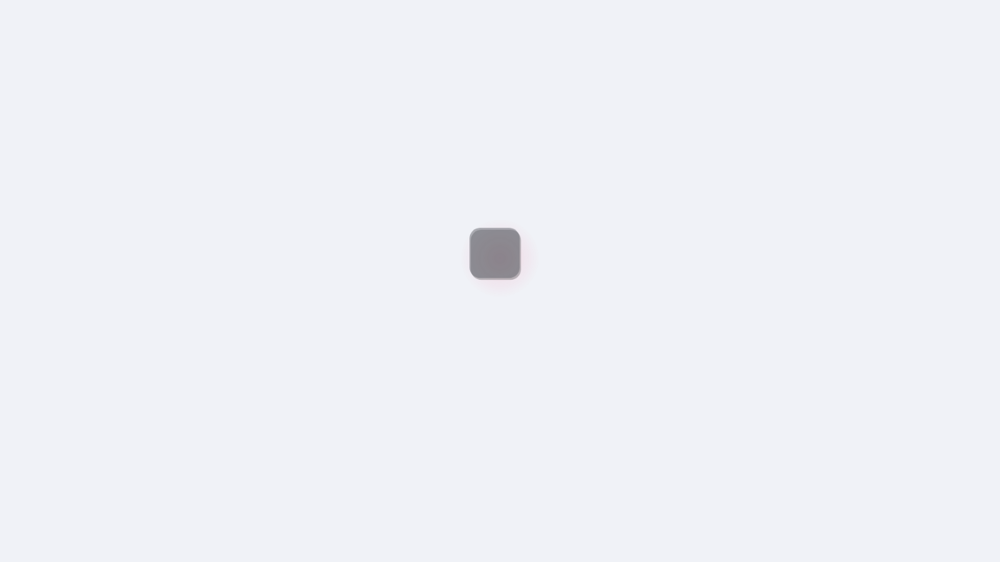
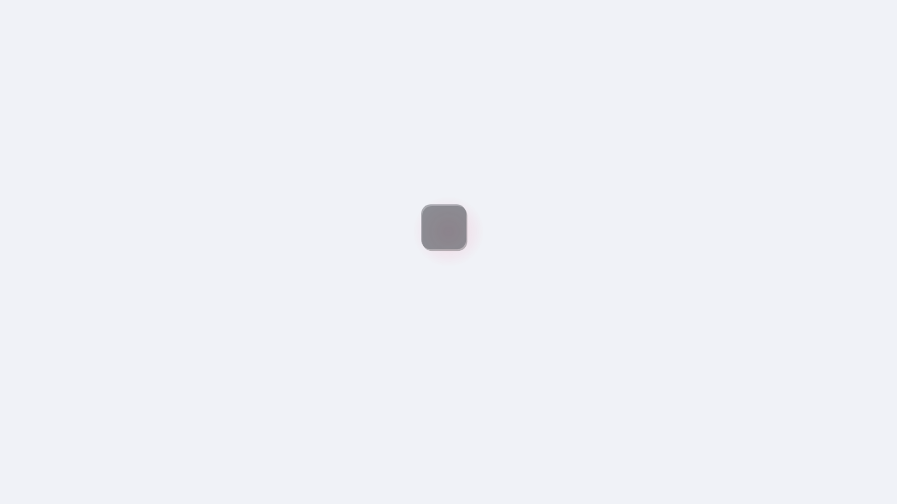

<div align="center">




<br/>

# RouterMod

**Route smarter. Spend less. Ship faster.**

A full redesign of [9Router](https://github.com/decolua/9router) — Neobrutalism UI, persistent CF tunneling, per-key model restrictions, live health monitoring, and a lot of quality-of-life improvements that make daily use actually enjoyable.

<br/>

[](#license)
[](https://github.com/decolua/9router)
[](#quick-start)
[](#tech-stack)

[Quick Start](#-quick-start) · [What's New](#-whats-different-from-9router) · [Features](#-features) · [Setup](#-setup) · [API](#-api)

</div>

---

<details>
<summary><b>🇮🇩 Baca dalam Bahasa Indonesia</b></summary>

## RouterMod — Panduan Bahasa Indonesia

RouterMod adalah fork dari 9Router yang di-redesign ulang dari nol. UI-nya pakai tema Neobrutalism 3D dengan aksen Cyber Crimson, tunneling ke domain publik otomatis, dan berbagai fitur tambahan yang bikin pengalaman sehari-hari jauh lebih enak.

### Mulai Cepat

```bash
git clone <repo> routermod && cd routermod
npm install
npm run dev          # dev mode, port 1945
# atau production:
node rebuild.js      # build + PM2 restart otomatis
```

Buka `http://localhost:1945` · Password default: `merdeka`

### Integrasi ke Claude Code / Cline / Cursor

```
Endpoint : http://localhost:1945/v1
API Key  : ambil dari Dashboard → Endpoint
Model    : kr/claude-sonnet-4.5
```

### Perbedaan dari 9Router

| | 9Router | RouterMod |
|---|---|---|
| **Rename / re-prefix model** | Tidak bisa | Edit prefix, model ID, display name per model |
| **Custom model CRUD** | Terbatas | Edit ID, nama, hapus; fetch live dari `/models` |
| **Disable/enable model** | Tidak ada | Nonaktifkan model tertentu; Bulk Disable/Enable All |
| **Strategi routing provider** | Fixed | Toggle Round Robin + Sticky limit yang bisa diatur |
| **Thinking mode** | Tidak ada | Pilih level reasoning per provider |
| **Proxy per connection** | Tidak ada | Assign proxy pool per connection; bulk assign |
| **Deploy proxy relay** | Tidak ada | Deploy ke Vercel / CF / Netlify / Deno langsung dari dashboard |
| **Custom headers** | Tidak ada | Override header per provider, diff-on-save |
| **Whitelist model per API key** | Tidak ada | Batasi tiap API key hanya ke model/combo tertentu |
| **Auto-ping quota reset** | Tidak ada | Ping otomatis saat reset 5 jam |
| **Reorder priority connection** | Tidak ada | Drag atau panah atas/bawah untuk atur urutan fallback |
| **Bulk import akun** | Tidak ada | Import massal Codex, Grok CLI, Antigravity |
| **Test semua model** | Satu per satu | Jalankan semua sekaligus, progress bar, bisa distop |
| **Suggested models** | Tidak ada | Chip model belum dikonfigurasi — klik langsung tambah |
| **Tunneling publik** | Tidak ada | CF Tunnel + CF DNS + Caddy/Nginx, subdomain persisten |
| **Dashboard access gate** | Tidak ada | Blokir dashboard di domain publik, API tetap jalan |
| **Live server monitoring** | Tidak ada | CPU/RAM/disk/host, auto-refresh 3 detik |
| **OAuth flow** | Copy-paste URL manual | Auto-buka tab baru |
| **Status free provider** | Offline jika 0 akun | Selalu ONLINE + tampil `∞` |

### Tunneling Publik

1. Dashboard → Settings → Tunnel
2. Isi Cloudflare API Token + Zone ID + subdomain
3. Klik **Enable** — Caddy + CF DNS jalan otomatis
4. Subdomain tidak berubah walau di-restart

### Tips: Gratis Total

```
Combo free-combo:
  1. kr/claude-sonnet-4.5   (Claude 4.5 via Kiro, ~50 kredit/bulan)
  2. kr/glm-5               (GLM-5 via Kiro)
  3. oc/<auto>              (OpenCode Free, no auth)
Biaya: Rp 0
```

</details>

---

## 🚀 Quick Start

```bash
git clone <repo-url> routermod
cd routermod
npm install
npm run dev
```

Open `http://localhost:1945` — default password is `merdeka`.

**Production with PM2:**

```bash
node rebuild.js   # stops PM2 → builds → restarts
```

**Wire up your AI tool:**

```
Endpoint : http://localhost:1945/v1
API Key  : grab one from Dashboard → Endpoint tab
Model    : kr/claude-sonnet-4.5
```

---

## ✨ What's Different from 9Router

RouterMod keeps everything that makes 9Router good and fills in the gaps that make daily use frustrating.

| | 9Router | RouterMod |
|---|---|---|
| **Model rename / re-prefix** | Not possible | Edit prefix, model ID, and display name per model |
| **Custom model CRUD** | Basic add only | Full edit — change ID, name, delete; live fetch from `/models` |
| **Model disable / enable** | Not available | Disable per-model; bulk Disable All / Enable All |
| **Provider routing strategy** | Fixed | Round Robin toggle + configurable Sticky limit |
| **Thinking mode per provider** | Not available | Auto / low / medium / high dropdown per provider |
| **Proxy per connection** | Not available | Assign a proxy pool per connection; bulk rotate or single pool |
| **Proxy relay deployment** | Not available | Deploy to Vercel / Cloudflare / Netlify / Deno from the dashboard |
| **Custom headers per provider** | Not available | Override or add headers per provider; diff-on-save |
| **API key model whitelist** | Not available | Restrict each API key to specific models or combos |
| **Auto-ping on quota reset** | Not available | Per-connection toggle — fires on 5-hour reset automatically |
| **Connection priority reorder** | Not available | Arrow up/down to reorder fallback priority |
| **Bulk account import** | Not available | Bulk import for Codex, Grok CLI, Antigravity |
| **Test all models at once** | One at a time | Run all models in sequence, live progress bar, stop anytime |
| **Suggested models** | Not available | Chips for unconfigured models (≥200k ctx, free) — click to add |
| **Public tunneling** | Not available | CF Tunnel + CF DNS + Caddy/Nginx; subdomain persists across restarts |
| **Dashboard access gate** | No control | Block web UI on public domain, keep API open |
| **Live server monitoring** | Not available | CPU, RAM, disk, host info — auto-refreshes every 3s |
| **OAuth flow** | Copy & paste URL manually | Auto-opens in new tab |
| **Free provider status** | Offline when 0 accounts | Always ONLINE + shows `∞` |

---

## 💡 Features

### Inherited from 9Router

| Feature | Description |
|---|---|
| 🚀 **RTK Token Saver** | Compresses tool output (`git diff`, `grep`, `ls`) — saves 20–40% input tokens |
| 🪨 **Caveman Mode** | Forces terse responses — saves up to 65% output tokens |
| 🐴 **Ponytail** | Lazy senior dev prompt — YAGNI-first, minimal code |
| 🎯 **3-Tier Fallback** | Auto-routes: Subscription → Cheap → Free, zero downtime |
| 📊 **Quota Tracking** | Live token count + reset countdown per provider |
| 🔄 **Format Translation** | OpenAI ↔ Claude ↔ Gemini ↔ Cursor ↔ Kiro ↔ Vertex |
| 👥 **Multi-Account** | Round-robin or priority routing per provider |
| 🔄 **Auto Token Refresh** | OAuth tokens refresh in the background |
| 🎨 **Custom Combos** | Unlimited model combinations with fallback chains |
| 📝 **Request Logging** | Full request/response debug logs |
| 📊 **Usage Analytics** | Tokens, cost, trends per provider and model |

### Added in RouterMod

| Feature | Description |
|---|---|
| 🌐 **Auto CF Tunneling** | Persistent public subdomain via Cloudflare Tunnel + DNS |
| 🔀 **Auto Reverse Proxy** | Caddy (Windows) / Nginx (Linux) — zero manual config |
| 🔒 **Dashboard Access Gate** | Block web UI on public domain, keep API accessible |
| ⚡ **Test All Models** | Run all models at once, live progress bar, 1 summary toast |
| ♾️ **Free Provider Status** | noAuth providers always show ONLINE + `∞` account count |
| 📡 **Live Server Tab** | CPU, RAM, disk I/O, host info — auto-refreshes every 3s |
| 👥 **Antigravity Bulk Import** | Import accounts in bulk via `email|password` format |
| 🎨 **Neobrutalism UI** | 3D offset-shadow theme, Cyber Crimson accent, dark mode |
| 🔔 **Community Links** | Telegram + WhatsApp on every dashboard visit |
| 🌍 **OAuth Auto Popup** | No manual URL step — OAuth opens automatically |

---

## 🌐 Supported Providers

### 🔐 OAuth (login once, auto-refresh forever)
Claude Code · Antigravity · Codex · GitHub Copilot · Cursor · Kiro AI · Xiaomi Mimo · Zed

### 🆓 Free Tier (no API key needed)

| Provider | Models | Notes |
|---|---|---|
| **Kiro AI** | Claude 4.5, GLM-5, MiniMax | ~50 credits/month |
| **OpenCode Free** | Auto-fetched from opencode.ai | No sign-up required |
| **Vertex AI** | Gemini 3 Pro, DeepSeek, GLM | $300 free credits for new GCP accounts |

### 🔑 API Key (40+ providers)
OpenRouter · OpenAI · Anthropic · Gemini · DeepSeek · Groq · xAI · Mistral · GLM · MiniMax · Kimi · Perplexity · Together AI · Fireworks · Cerebras · Cohere · NVIDIA · SiliconFlow · Nebius · Hyperbolic · and more

---

## 🛠️ Supported CLI Tools

Claude Code · OpenClaw · Codex · OpenCode · Cursor · Antigravity · Cline · Continue · Roo · Copilot · Kilo Code · Droid · Grok Build · Devin CLI · DeepSeek TUI · Qwen Code · jcode · and more

---

## 📖 Setup

### Environment Variables

Copy `.env.example` to `.env.local`:

```env
PORT=1945
HOSTNAME=0.0.0.0
NODE_ENV=production
JWT_SECRET=change-this-to-something-long-and-random
INITIAL_PASSWORD=merdeka
DATA_DIR=%APPDATA%\routermod
```

### PM2 Production

```bash
node rebuild.js      # build + restart in one command

pm2 status           # check process
pm2 logs routermod   # live logs
```

`ecosystem.config.js` points PM2 at `.next/standalone/custom-server.js` and sets `NODE_ENV: production` with `HOSTNAME: 0.0.0.0`.

### Public Tunneling (Cloudflare)

1. Dashboard → Settings → Tunnel
2. Enter your Cloudflare API Token, Zone ID, and target subdomain
3. Hit **Enable** — Caddy + CF DNS configure themselves
4. The subdomain stays the same across restarts; it only regenerates when you disable and re-enable

### CLI Integration

**Claude Code / Cline / Cursor / Roo:**
```json
{
  "baseUrl": "http://localhost:1945/v1",
  "apiKey": "sk-from-dashboard"
}
```

**Codex CLI:**
```bash
export OPENAI_BASE_URL="http://localhost:1945/v1"
export OPENAI_API_KEY="sk-from-dashboard"
```

---

## 📊 Combo Examples

**Zero cost:**
```
1. kr/claude-sonnet-4.5   → Kiro free (~50 credits/mo)
2. kr/glm-5               → GLM-5 via Kiro
3. oc/<auto>              → OpenCode Free, no auth
Monthly cost: $0
```

**Maximize your subscription:**
```
1. cc/claude-opus-4-7     → Claude Code (subscription)
2. glm/glm-5.1            → $0.6/1M tokens backup
3. kr/claude-sonnet-4.5   → Kiro free fallback
```

---

## 🛠️ Tech Stack

| Layer | Technology |
|---|---|
| Runtime | Node.js 20+ |
| Framework | Next.js + React 19 |
| Styling | Tailwind CSS 4 |
| Database | SQLite via better-sqlite3 |
| Streaming | Server-Sent Events (SSE) |
| Auth | OAuth 2.0 (PKCE) + JWT + API Keys |
| Process | PM2 standalone mode |
| Tunnel | Cloudflare Tunnel + Caddy |

---

## 📝 API

```bash
# Chat completions
curl http://localhost:1945/v1/chat/completions \
  -H "Authorization: Bearer <api-key>" \
  -H "Content-Type: application/json" \
  -d '{"model":"kr/claude-sonnet-4.5","messages":[{"role":"user","content":"hi"}],"stream":true}'

# List available models
curl http://localhost:1945/v1/models \
  -H "Authorization: Bearer <api-key>"
```

Compatible with any OpenAI-format client.

---

## 🙏 Credits

Built on top of great open-source work:

- **[9Router](https://github.com/decolua/9router)** — the upstream AI router this is forked from
- **[RTK](https://github.com/rtk-ai/rtk)** — token compression pipeline
- **[Caveman](https://github.com/JuliusBrussee/caveman)** — terse output prompt
- **[Ponytail](https://github.com/DietrichGebert/ponytail)** — lazy senior dev prompt

---

## 📄 License

MIT — see [LICENSE](LICENSE).

---

<div align="center">
  <sub>Fork of 9Router · Neobrutalism UI · Auto CF Tunneling · Port 1945</sub>
</div>
