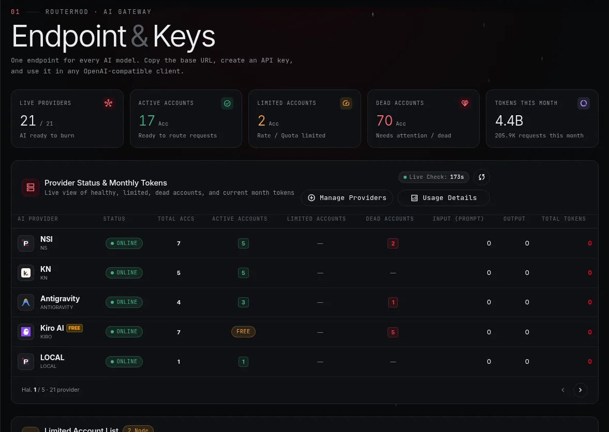
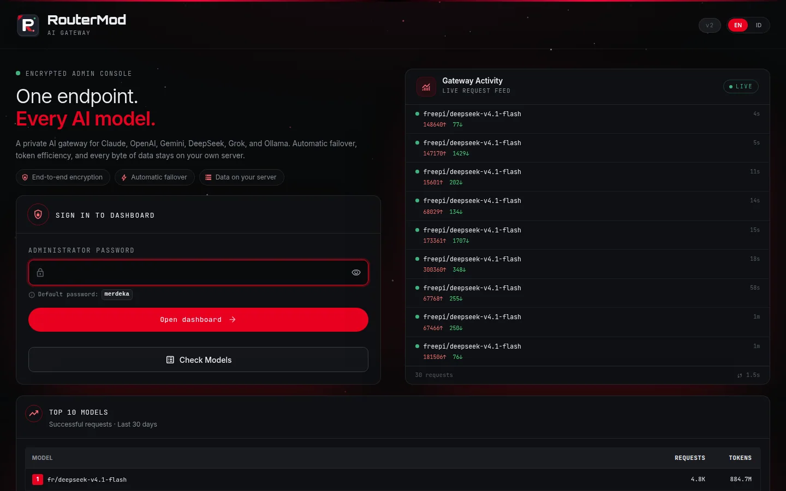
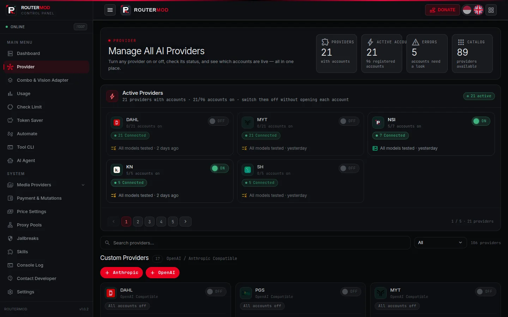
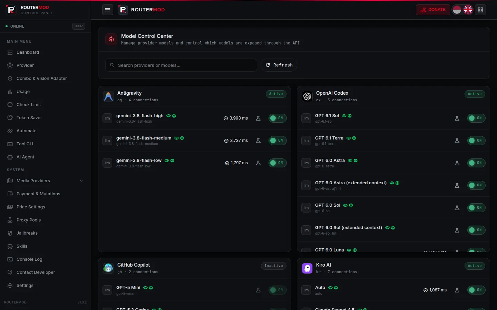
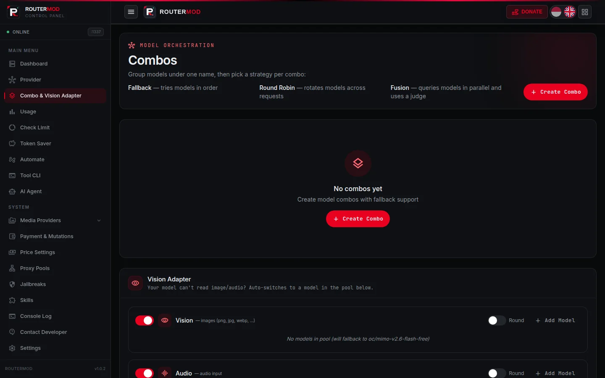
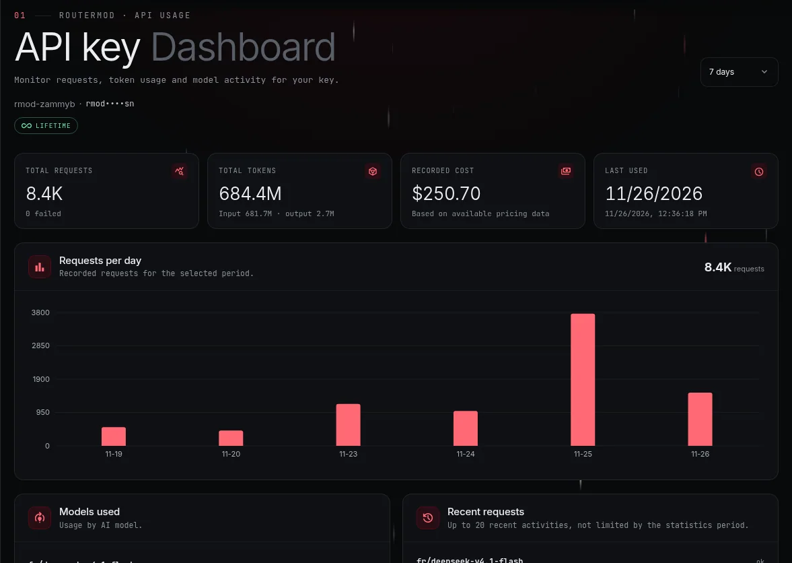
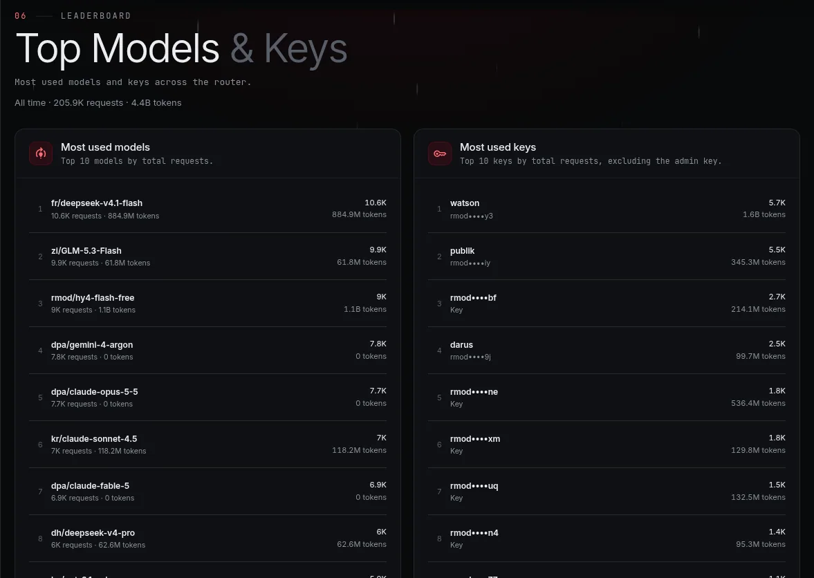
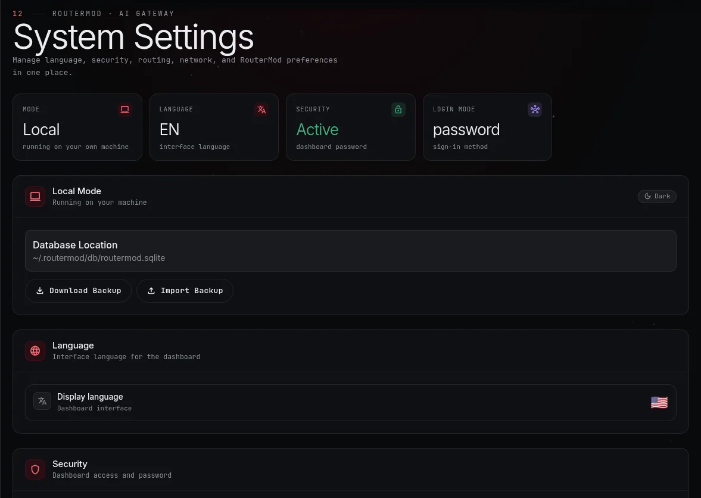

<div align="center">

# RouterMod

**One gateway for your AI providers, models, and coding tools.**

A self-hosted AI gateway built on [9Router](https://github.com/decolua/9router), with a redesigned dashboard for managing connections, routing requests, and tracking usage.

[](LICENSE)
[](https://nodejs.org/)
[](https://www.npmjs.com/package/@techwiz37/routermod)
[](https://github.com/decolua/9router)

[Screenshots](#screenshots) · [Features](#features) · [Quick start](#quick-start) · [API usage](#api-usage) · [Configuration](#configuration)

<sub><strong>English</strong> · <a href="#ringkasan-bahasa-indonesia">Bahasa Indonesia</a></sub>

<a href="images/routermod-overview.webp"></a>

<sub>The Endpoint &amp; Keys overview: provider health, active accounts, and monthly token usage at a glance. Click any screenshot to view it at full size.</sub>

</div>

## Overview

RouterMod brings multiple AI services behind a local API endpoint. Connect providers with OAuth or API keys, choose the models available to your clients, and build routing combinations with fallback or round-robin strategies.

Use it with clients that support a custom OpenAI-compatible base URL, or configure supported coding tools through the dashboard. Requests are forwarded to your configured upstream providers; their availability, quotas, and pricing still apply.

<a id="ringkasan-bahasa-indonesia"></a>

<details>
<summary><strong>Ringkasan Bahasa Indonesia</strong></summary>

RouterMod adalah AI gateway yang bisa dijalankan di komputer atau server sendiri. Kelola akun provider, model, API key, routing, dan statistik pemakaian dari satu dashboard.

- Hubungkan provider melalui OAuth, API key, atau endpoint kompatibel.
- Gunakan satu base URL untuk aplikasi dan coding tools yang mendukungnya.
- Atur model yang boleh diakses tiap API key serta urutan fallback melalui combo.
- Pantau request, token, dan estimasi biaya. Halaman Top Models & Keys merangkum seluruh riwayat pemakaian.

Untuk mulai, ikuti [Quick start](#quick-start), buka `http://localhost:1337`, lalu tambahkan provider dan buat API key. Password awal adalah `merdeka` jika belum diganti atau diatur melalui `INITIAL_PASSWORD`.

</details>

## Screenshots

Screenshots below show the current dark theme on a running RouterMod instance. Provider names, model availability, account counts, and usage reflect that instance, rather than a bundled service plan.

### Login and live activity

Sign in while viewing recent gateway activity and the Top Models ranking, based on successful requests over the last 30 days.

<a href="images/routermod-login.webp"></a>

### Provider management

Turn providers on or off, check connection health, and see which accounts are live. Custom OpenAI- and Anthropic-compatible endpoints appear alongside the built-in integrations.

<a href="images/routermod-providers.webp"></a>

### Model Control Center

Browse provider catalogs, search model names, and control which models are exposed through the API.

<a href="images/routermod-models.webp"></a>

### Combos and Vision Adapter

Group models under one name and choose a routing strategy. The screenshot shows the initial combo state and the vision and audio adapter configuration.

<a href="images/routermod-combos.webp"></a>

### API key dashboard

Every API key gets its own usage view: requests per day, token totals, recorded cost, models used, and recent requests. Switch the period for a shorter window or use the lifetime summary.

<a href="images/routermod-dashboard-keys.webp"></a>

### All-time leaderboard

Top Models &amp; Keys ranks the most used models and keys by total requests across all recorded usage. Key names are masked unless you are signed in with the admin key.

<a href="images/routermod-top-models-keys.webp"></a>

### System settings

Manage dashboard language, password and login mode, routing and network preferences, and local database backups from one page.

<a href="images/routermod-profile.webp"></a>

## Features

| Area | What you can do |
| --- | --- |
| **Provider management** | Connect OAuth and API-key providers, add compatible endpoints, and manage multiple accounts. |
| **Model controls** | Edit model names and prefixes, fetch supported catalogs, and enable or disable individual models. |
| **Routing and combos** | Configure priority or round-robin account routing and group models into fallback, round-robin, or fusion combos. |
| **API access** | Create API keys and restrict their access to selected models or combos. |
| **Protocol translation** | Route supported OpenAI, Anthropic, and Gemini request formats through provider-specific translators. |
| **Usage and diagnostics** | Inspect request activity, token usage, estimated costs, quota information, and console logs. |
| **Token optimization** | Configure tool-output compression and prompt options in Token Saver. Results depend on the workload. |
| **Networking** | Manage proxy pools and configure public access through the available tunnel settings. |
| **Dashboard** | Use light or dark themes, English or Indonesian labels, and server monitoring tools. |

### Providers and clients

The catalog includes services such as OpenAI, Anthropic, Gemini, OpenRouter, DeepSeek, Groq, xAI, Mistral, and Ollama, alongside supported OAuth integrations such as Codex, Claude Code, GitHub Copilot, and Kiro.

You can also add **OpenAI-compatible** or **Anthropic-compatible** upstream endpoints. The dashboard is the source of truth for the available integrations and authentication methods in your installed version.

Clients such as OpenCode, Cline, Continue, Roo Code, and other tools with configurable API endpoints can use the gateway. Available features, including tools, images, reasoning, and streaming, depend on both the client and the selected provider/model.

## Quick start

Use **Node.js 20.9 or later** and npm. A current Node.js LTS release is recommended for source builds.

### Run the published package

```bash
npx @techwiz37/routermod
```

Or install the CLI globally:

```bash
npm install -g @techwiz37/routermod
routermod
```

Open **[http://localhost:1337](http://localhost:1337)**. The initial dashboard password is `merdeka` unless `INITIAL_PASSWORD` is set or a password has already been saved. Change it in Settings before making the dashboard publicly accessible.

### Run from source

```bash
git clone https://github.com/techwiz37/routermod.git
cd routermod
npm install
npm run dev
```

For a production build:

```bash
npm run build
npm start
```

The build includes a postbuild step that prepares standalone assets. The production server currently listens on port **1337**, bound to `0.0.0.0`, as defined in [`custom-server.js`](custom-server.js).

<details>
<summary><strong>Keep the production server running with PM2</strong></summary>

With PM2 installed, run these commands from the repository directory:

```bash
npm run build
pm2 start custom-server.js --name routermod
pm2 save
```

Inspect the service:

```bash
pm2 status
pm2 logs routermod
```

After updating the source, rebuild before restarting:

```bash
npm run build
pm2 restart routermod --update-env
```

</details>

### Connect your first client

1. Open **Provider** and connect an account or add a compatible endpoint.
2. Enable the models you want to use in **Model Control Center** or the provider settings.
3. Open **Dashboard** and create an API key in the endpoint section.
4. Set your client's base URL to `http://localhost:1337/v1`, supply that API key, and select an available model ID.

| Client setting | Value |
| --- | --- |
| Base URL | `http://localhost:1337/v1` |
| API key | The key you created in the dashboard |
| Model | An enabled ID returned by `/v1/models`, or a configured combo name |

## API usage

The examples use an OpenAI-compatible API. Replace `<api-key>` with a dashboard key and `<model-id>` with a model available to that key.

### List available models

```bash
curl http://localhost:1337/v1/models \
  -H "Authorization: Bearer <api-key>"
```

### Stream a chat completion

```bash
curl --no-buffer http://localhost:1337/v1/chat/completions \
  -H "Authorization: Bearer <api-key>" \
  -H "Content-Type: application/json" \
  -d '{
    "model": "<model-id>",
    "messages": [{"role": "user", "content": "Explain this project in one sentence."}],
    "stream": true
  }'
```

For clients that read OpenAI environment variables:

```bash
export OPENAI_BASE_URL="http://localhost:1337/v1"
export OPENAI_API_KEY="<api-key>"
```

Client-specific configuration may still be required. Use **Tool CLI** in the dashboard for the integrations supported by your version.

## Configuration

Most settings are managed through the dashboard. For source deployments, optional environment variables can be set in `.env.local`; for a process manager, provide them in the process environment.

| Variable | Purpose | Default behavior |
| --- | --- | --- |
| `INITIAL_PASSWORD` | Initial dashboard password before a password is saved. | Falls back to `merdeka`. |
| `JWT_SECRET` | Secret used to sign dashboard sessions. | Generated and persisted in the data directory when unset. |
| `DATA_DIR` | Custom directory for persistent application data. | `~/.routermod` on Linux/macOS; `%APPDATA%\routermod` on Windows. |
| `AUTH_COOKIE_SECURE` | Set to `true` to require secure dashboard cookies. | HTTPS detection also uses the forwarded protocol. |

Example for a source deployment:

```dotenv
INITIAL_PASSWORD=replace-with-a-private-password
JWT_SECRET=replace-with-a-long-random-secret
```

Back up the persistent data directory when moving or upgrading an instance. It contains configuration and sensitive credentials; keep it out of version control.

### Public access

Configure tunnels through the dashboard's tunnel settings and supply the credentials required by the selected method. For a named Cloudflare setup, this includes your own Cloudflare account and DNS configuration.

When using a reverse proxy, forward to port `1337` and configure HTTPS. Dashboard access controls and API-key restrictions can be managed separately. Do not use the initial password on a public instance.

## Development

| Component | Technology |
| --- | --- |
| Application | Next.js 16 and React 19 |
| Styling | Tailwind CSS 4 and custom CSS |
| Persistence | SQLite through better-sqlite3 |
| Streaming | Server-Sent Events (SSE) and provider-specific stream adapters |
| Authentication | Provider OAuth flows, dashboard JWT sessions, and gateway API keys |

Useful commands:

```bash
npm run dev       # Local development on port 1337
npm run build     # Production build and standalone asset preparation
npm start         # Production server
```

Report bugs or request features through [GitHub Issues](https://github.com/techwiz37/routermod/issues). Include the provider, model, relevant error, and reproduction steps, with credentials removed.

## Credits

- [9Router](https://github.com/decolua/9router), the upstream project RouterMod builds on.
- [RTK](https://github.com/rtk-ai/rtk), tool-output compression inspiration.
- [Caveman](https://github.com/JuliusBrussee/caveman) and [Ponytail](https://github.com/DietrichGebert/ponytail), prompt modes referenced by the project.

## License

Distributed under the [MIT License](LICENSE).
